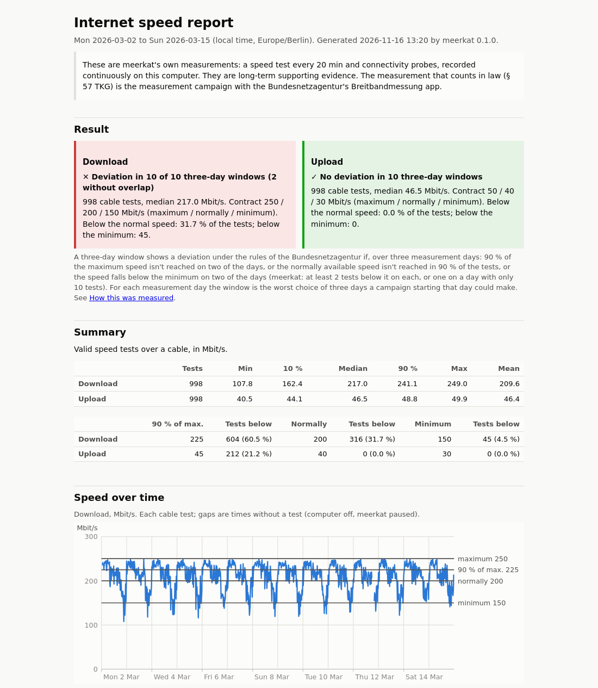

# meerkat

[](https://github.com/carloslinares-eu/meerkat/actions/workflows/ci.yml)

**Keeps watch over your internet connection and records evidence when it's
slower than your contract says.**

meerkat runs on a Linux computer connected to your router. It runs a speed test
on a schedule (every 30 minutes by default) and checks connectivity every 30 s.
It records every result with its context: time, interface, test server, and
whether the measurement ran over a cable or Wi-Fi. `meerkat report` then
compares the data with the speeds in your contract and produces a printable
report you can send to your provider.

It's built with German providers in mind. The report checks the
Bundesnetzagentur rules (maximum, normally available and minimum speeds) and
works next to the official *Breitbandmessung* app, not instead of it.

> **Status:** recording (`run`, `once`, `check`, `pause`), the report,
> `verify`, `export` and `advise-bbm` work, and releases ship a .deb and a
> binary. Still to come: reading the Breitbandmessung app's protocol into
> the report (`import-bbm`). The plan is in [PLAN.md](PLAN.md) and the task
> list in [DEVPLAN.md](DEVPLAN.md). How it started: *Origin* below.

[](docs/sample-report.png)

*The top of a sample report. The line, the tariff (250/200/150 down,
50/40/30 up) and the data are made up, by
[`docs/sample/make-sample-data.py`](docs/sample/make-sample-data.py).*

## Quick start

On Debian 13 or Ubuntu 24.04, with the computer connected to the router
by a cable:

1. Download the `.deb` from the latest
   [release](https://github.com/carloslinares-eu/meerkat/releases) and
   install it: `sudo apt install ./meerkat_X.Y.Z_amd64.deb`.
2. Install the Ookla Speedtest CLI (see "Install the Ookla CLI" below).
3. Put your contract's speeds in the config: `sudoedit /etc/meerkat/config.toml`,
   section `[contract]` (see "Configuration"). Pin a test server there
   too (`server_id`).
4. Let yourself read the data: `sudo adduser $USER meerkat`, then log in
   again.
5. Start recording, and watch the first tests come in:

   ```sh
   sudo systemctl enable --now meerkat
   sudo journalctl -u meerkat -f
   ```
6. After a week or two:

   ```sh
   meerkat report --config /etc/meerkat/config.toml --data-dir /var/lib/meerkat
   ```

   It writes `meerkat-report-FROM-to-TO.html` in the current folder. Open it
   in a browser, and print it to PDF from there.

*Collecting evidence* below says how to make the data hold up, and how it
fits with the official measurement.

## Download

Each [release](https://github.com/carloslinares-eu/meerkat/releases) has:
- `meerkat_X.Y.Z_amd64.deb` for Debian 13 and Ubuntu 24.04 or later (see
  *Run as a service*);
- `meerkat-X.Y.Z-linux-x86_64.tar.gz`: the binary for any x86-64 Linux with
  glibc 2.39 or later and libsystemd, with the licence notices, the example
  config and the service files. Unpack it, then run `./meerkat` directly, or
  install the service with `sudo packaging/install.sh` from the unpacked
  folder;
- `SHA256SUMS`: check the download with `sha256sum -c --ignore-missing SHA256SUMS`.

To make a release, set the version in `CMakeLists.txt`, merge, then push a
tag `vX.Y.Z` on `main`. The workflow `.github/workflows/release.yml` builds
and tests both, and publishes the release.

## Build

Needs CMake ≥ 3.25, Ninja, a C++20 compiler (GCC 12+), `pkg-config` and
libsystemd and zlib (`sudo apt install pkg-config libsystemd-dev zlib1g-dev`). The other dependencies
(CLI11, nlohmann/json, toml++, doctest) are downloaded at configure time.

```sh
cmake --preset release        # or: debug, asan
cmake --build --preset release
ctest --preset release
./build/release/meerkat --version
```

## Use

```sh
meerkat check   # config, tools, data directory, connection, sleep lock
meerkat once    # measure once and print the result
meerkat run     # record until Ctrl+C / SIGTERM
meerkat pause --for 2h   # no speed tests for 2 hours (official measurement)
meerkat resume           # end the pause early
meerkat report --from 2026-03-01 --to 2026-03-14 -o report.html
```

`meerkat run` writes `speed.csv`, `connectivity.csv`, the raw speed-test
output (`raw/`) and a daily SHA-256 manifest (`manifest/`) to the data
directory (default `~/.local/share/meerkat`). It keeps the computer from
suspending while it runs, warns when the connection is Wi-Fi, and logs
outages as they start and end. Only one `meerkat run` records into a data
directory at a time: it locks the directory, and a second one stops at once.
On file systems that can't lock a directory (NFS, for example) it only warns,
so make sure yourself that just one is running. Settings: see
[`config.example.toml`](config.example.toml).

While the Breitbandmessung app (Festnetz-Check) runs, `meerkat run` pauses
its speed tests by itself (rows with status `paused_official`) and probes the
connection less often, so it doesn't lower the official result; a speed test
already running when the app starts is stopped. `meerkat once` doesn't start
its speed test either, or stops it, the same way. If meerkat can't see the app
(it runs as another user, or on another computer on the same line), pause by
hand with `meerkat pause --for <duration>`.

`meerkat report` writes the evidence report: one HTML file with no scripts
and no external files, which prints to PDF from the browser. It has the
verdict per direction under the three BNetzA rules, the summary, charts
(speed over time with the contract lines, by hour of day, outages), the
day-by-day and three-day-window tables, the outage list, tests over Wi-Fi or
a VPN (listed apart, never compared with the contract), the measurement setup
and the manifest hashes. `--from`/`--to` are local days (default: from the
first test to today); the contract comes from `[contract]` in the config or
from `--contract-down`/`--contract-up`. It only reads the data directory, so
it can run while `meerkat run` records.

`meerkat advise-bbm` helps with the official campaign. It uses the last
four weeks of cable tests (`--from`/`--to` to change that) and ranks the
local hours and weekdays by how often the line was below the normally
available and the minimum speed. It then suggests:
- three days from tomorrow (`--start` to change that), with a free day
  between them, within 14 days;
- two hours on each of those days, at least 4 hours apart, for the two
  blocks of five measurements.

It prints this together with the campaign's rules, and it needs the
contract figures. `meerkat report --advice` adds the same advice to the
report as a section. It is left out by default, and `export` never
includes it, because the report may go to the provider and the plan
shouldn't.

`meerkat verify` checks the evidence trail before you hand it over. It reads
every daily manifest, hashes each file it sealed again and lists it as ok,
changed, grew, shorter or missing. It also checks the chain (each manifest
includes the one before it) and reports days with data but no manifest, and
raw logs created after their day was sealed. Data from today and yesterday
that isn't sealed yet is only a note. The exit code is 1 if anything is
wrong. Like `report`, it only reads the data directory. `--as-of YYYY-MM-DD`
checks as of another day: an export bundle is checked as of the day it was
made, so days after it aren't expected to be sealed.

`meerkat export [--from --to] [-o FILE]` writes one ZIP file for the
provider. It contains:
- the report for those days;
- the `verify` result, checked when the data was copied;
- the data directory byte for byte (speed.csv, connectivity.csv, the raw
  logs and the manifests);
- a README that explains how to check it;
- `SHA256SUMS` for `sha256sum -c`.

The data is always the whole recording, because the manifests seal the
files as a whole. A file ends at its last complete line (a line still being
written is left out), but never before what a manifest sealed. The report is made just before the data is
copied, so the data has every test the report counts. If `verify` finds problems, the export still goes ahead and
the problems are listed in the bundle. Like the report, the file is
readable only by you.

## Collecting evidence

The aim is data the provider can't wave away. In short:

- **Cable, not Wi-Fi.** "It's your Wi-Fi" is the first answer to any
  complaint. Connect the computer to the router with a cable and switch its
  Wi-Fi off. meerkat records the link of every test (`link_type`), warns on
  Wi-Fi, and the report never compares Wi-Fi or VPN tests with the contract.
  `require_wired = true` skips them altogether.
- **Nothing else on the line.** Downloads, streaming or backups on other
  devices lower the result. You can't stop everything for weeks, but avoid
  big transfers, and mention what you can't avoid.
- **One test server.** Results from different servers aren't comparable.
  `speedtest -L` lists nearby servers; put one in `server_id`. The report
  lists the servers that were used.
- **Long enough.** Two to four weeks show whether slow hours come back
  every day. Keep the computer on and awake; meerkat stops it from
  suspending while it records.
- **Not too often.** Ookla blocks its CLI after too many tests ("Limit
  reached: Too many requests received"). At a test every 5 minutes that
  happened after about 3 hours; every 30 minutes (the default) ran for days.
  Ookla doesn't publish the limit. When it blocks, meerkat records
  `rate_limited` and waits 1 hour before trying again, then 2, 4, up to 8.
  Those rows are never counted against the line.
- **Data volume.** Each test downloads and uploads at full speed for about
  10–15 s each way. On a 250/50 line that is roughly half a gigabyte per
  test, so about 25 GB a day at the default interval. That's fine on a flat
  rate. Otherwise set a longer `interval`.
- **The official measurement counts in law.** A reduction of payment
  (§ 57 TKG) needs the Bundesnetzagentur's
  [Breitbandmessung](https://breitbandmessung.de) desktop app: 30
  measurements on three calendar days within 14 days, with a free day between
  measurement days. meerkat's data shows the pattern over weeks and supports
  that finding; it doesn't replace it. After a week or two of data,
  `meerkat advise-bbm` suggests the days and hours when the line was slowest.
  meerkat pauses itself while the app measures (see *Use*).
- **Hand it over intact.** `meerkat verify` checks that no recorded data was
  changed. `meerkat export` packs the report, the data and the verify result
  into one ZIP for the provider or the Bundesnetzagentur.

The report checks the three BNetzA rules for a significant deviation, per
direction, over three-day windows built like the official campaign. A
window deviates if any of these holds:
1. 90 % of the maximum speed isn't reached on two of the three days;
2. the normally available speed isn't reached in 90 % of the tests;
3. the speed falls below the minimum on two of the three days.

For rule 3 meerkat needs at least two tests below the minimum on a day,
since it tests far more often than the app. On a day with 10 tests or fewer,
one is enough, as on a campaign day.

## Configuration

meerkat reads one config file: the one given with `--config`, or else the
first readable one of `$XDG_CONFIG_HOME/meerkat/config.toml` (default
`~/.config/meerkat/config.toml`) and `/etc/meerkat/config.toml`. The files
aren't merged. Every setting is optional, and flags override the file. [`config.example.toml`](config.example.toml) has all of
them with comments. `meerkat check` shows what meerkat makes of the file.
The file holds your contract, so keep it private: `chmod 600` for your own
file. The service's `/etc/meerkat/config.toml` stays root:meerkat 0640, as
the package sets it, so the service can read it.

| Key | Default | Flag | What |
|---|---|---|---|
| `data_dir` | `$STATE_DIRECTORY` (service), else `$XDG_DATA_HOME/meerkat` (default `~/.local/share/meerkat`) | `--data-dir` | Where the data goes |
| `[speed] interval` | `"30m"` | `--speed-interval` | Time between speed tests, 1m to 24h (`"30s"`, `"5m"`, `"1h"` or seconds) |
| `[speed] backend` | `"ookla"` | | The speed-test program; only Ookla for now |
| `[speed] program` | `"speedtest"` | `--speedtest` | The Ookla CLI, by name or path |
| `[speed] server_id` | none (Ookla picks) | `--server-id` | Pin one test server |
| `[speed] require_wired` | `false` | `--require-wired` | Skip tests over Wi-Fi or a VPN instead of only warning |
| `[connectivity] interval` | `"30s"` | `--connectivity-interval` | Time between pings and DNS lookups, 5s to 1h |
| `[connectivity] ping_hosts` | `["1.1.1.1", "9.9.9.9"]` | `--ping` | Public hosts to ping |
| `[connectivity] ping_gateway` | `true` | | Also ping the router, to tell the line from the local network |
| `[connectivity] dns_host` | `"example.com"` | `--dns-host` | Host name whose lookup is timed |
| `[connectivity] outage_after` | `2` | | Rounds in a row in which no ping host answers (the router doesn't count) before it counts as an outage (1 to 20) |
| `[official] programs` | `["breitbandmessung"]` | | Programs that pause the speed tests while they run; `[]` turns this off |
| `[official] connectivity_interval` | `"2m"` | | Time between probes meanwhile |
| `[contract] download` | none | `--contract-down MAX/NORMAL/MIN` | `{ maximum = …, normal = …, minimum = … }` in Mbit/s, from the provider's *Produktinformationsblatt* |
| `[contract] upload` | none | `--contract-up MAX/NORMAL/MIN` | The same for the upload |

Without a contract, the report shows the measurements but no verdict.

## Data format

Everything goes into the data directory: `/var/lib/meerkat` for the
service, `$XDG_DATA_HOME/meerkat` (default `~/.local/share/meerkat`)
otherwise. All times are UTC (ISO 8601,
`2026-03-10T19:20:00Z`); numbers use `.` as the decimal point. A value that
wasn't measured is an empty field, never 0. The files are only appended to.

| File | What |
|---|---|
| `speed.csv` | One row per speed test |
| `connectivity.csv` | One row per ping target and DNS lookup |
| `raw/YYYY-MM-DD.jsonl` | The speed-test program's output, unchanged: one JSON line per test, per UTC day |
| `manifest/YYYY-MM-DD.sha256` | The day's seal (below) |
| `pause` | The end of a `meerkat pause`, while one is set |

**CSV files** (RFC 4180, CRLF). The first line names the layout
(`# meerkat speed v1`), the second has the column names. A change of columns
gets a new version, and meerkat won't append to a file with another
layout.

`speed.csv` columns: `time`, `status`, `error`, `backend`, `link_type`,
`interface`, `gateway`, `link_speed_mbps`, `wifi_ssid`, `wifi_bssid`,
`wifi_frequency_mhz`, `wifi_signal_dbm`, `wifi_rx_bitrate_mbps`,
`wifi_tx_bitrate_mbps`, `download_mbps`, `upload_mbps`, `latency_ms`,
`jitter_ms`, `packet_loss_percent`, `server_id`, `server_name`,
`server_location`, `isp`, `external_ip`, `result_url`.

`connectivity.csv` columns: `time`, `probe` (`ping` or `dns`), `target`,
`status`, `error`, `link_type`, `interface`, `gateway`, `sent`, `received`,
`loss_percent`, `rtt_min_ms`, `rtt_avg_ms`, `rtt_max_ms`, `rtt_mdev_ms`,
`duration_ms`. A ping of the router has `target` equal to `gateway`. Ping
rows leave `duration_ms` empty, DNS rows the ping columns.

`status` is one of: `ok`; `timeout`; `error`; `no_network` (no route);
`not_available` (the program is missing); `skipped_wlan` and
`skipped_tunnel` (`require_wired`); `paused_official` (the Breitbandmessung
app ran, or `meerkat pause`); `rate_limited` (Ookla refused: too many tests,
or meerkat waits for that limit to pass). `link_type` is `wired`, `wifi`, `tunnel` or
`unknown`.

**Raw logs.** Each line is a JSON object with `time`, `backend`, `status`,
`error` and the program's output as a string in `output` (or, if it isn't
valid UTF-8, in `output_base64`). The CSV values can be checked against it.

**Manifests.** Just after midnight UTC, `meerkat run` writes the day's
manifest and makes it read-only:

```
# meerkat manifest v1
# day 2026-03-10
# created 2026-03-11T00:00:05Z
<sha256>  <size in bytes>  <path relative to the data directory>
```

It lists the raw logs of that day and the day before, the two CSV files as
they were then, and the previous manifest. The CSV files and the day's own
raw log may still grow: a later check hashes their first `size` bytes, so
rows added since don't matter, but any change to an older row does. The raw
log of the day before and the previous manifest are complete by then, so
they must not have grown either (`verify` reports `grew`). Because each manifest includes the one before, removing
or editing one breaks the chain. `meerkat verify` checks all of it.

## Install the Ookla CLI

meerkat measures with the Ookla Speedtest CLI (`speedtest`). It isn't part
of meerkat and isn't in Debian. Debian's `speedtest-cli` package is a
different program and doesn't work with meerkat. Get it from Ookla:

1. Download the Linux build for your CPU (x86_64 for most PCs) from
   <https://www.speedtest.net/apps/cli> ("Download for Linux").
2. Unpack it and put the program on the system's `PATH`:

   ```sh
   tar -xzf ookla-speedtest-*-linux-x86_64.tgz speedtest
   sudo install -m 0755 speedtest /usr/local/bin/speedtest
   ```

Ookla also offers an apt repository, set up by a script run as root. The
download above avoids that. Read Ookla's terms first (see *Licence
compliance*): meerkat accepts them for you each time it runs the CLI.

## Run as a service

To record around the clock, even with nobody logged in, install meerkat as
a systemd service. There are two ways:
- **the .deb** (Debian 13, Ubuntu 24.04 and later): files in `/usr`,
  updates and removal with `apt`;
- **`packaging/install.sh`**: any systemd distribution, files in
  `/usr/local`.

Both set the service up the same way.

### From the .deb

Download it from a release (*Download* above), or build it:

```sh
cmake --preset deb && cmake --build --preset deb && cpack --preset deb
sudo apt install ./build/deb/meerkat_*_amd64.deb
```

The package:
- installs `/usr/bin/meerkat`, the service and a default
  `/etc/meerkat/config.toml` (root:meerkat, 0640);
- creates the user `meerkat`, but doesn't enable or start the service.

Put your contract in the config, install the Ookla CLI (above), then:

```sh
sudo systemctl enable --now meerkat
systemctl status meerkat    # and: sudo journalctl -u meerkat
```

An upgrade restarts a running service, and leaves it enabled or disabled as
it was. The config's owner and mode are set with `dpkg-statoverride`, so an
override of your own stays. The config is a conffile: `apt`
keeps your changes, and asks if the package's default changed too.
`apt remove` stops and disables the service. `apt purge` also deletes the
config. Neither deletes the recorded data in `/var/lib/meerkat` or the
user `meerkat`. The licence notices are in `/usr/share/doc/meerkat/`.

To read the data and the config without sudo, add yourself to the group
`meerkat` (`sudo adduser $USER meerkat`) and log in again.

Coming from `install.sh`: run `sudo packaging/install.sh --uninstall`
first. It keeps the data and the config. Then install the package. `apt`
asks whether to keep the existing `/etc/meerkat/config.toml`: keep it.

### With install.sh

From the unpacked release archive, run `sudo packaging/install.sh` there.
From the source, build first, then install as root:

```sh
cmake --preset release && cmake --build --preset release
sudo packaging/install.sh --config ~/.config/meerkat/config.toml
```

The service:
- runs as its own user `meerkat`, with its data in `/var/lib/meerkat` and
  its config in `/etc/meerkat/config.toml`;
- is sandboxed: read-only system, no access to home directories, no
  capabilities, and only the network, netlink and the system bus.
  `systemd-analyze security meerkat` rates it about 1.5 ("OK");
- comes with a polkit rule (`/etc/polkit-1/rules.d/50-meerkat.rules`) that
  lets the user `meerkat` take logind's sleep, idle and lid locks.
  logind's own policy gives them only to someone logged in at the computer,
  so without the rule the computer could suspend.

`install.sh` options:
- `--config FILE` copies your config, with the contract figures, to
  `/etc/meerkat`. Without it, the example config is installed if there is
  none yet.
- `--import-data ~/.local/share/meerkat` carries an existing evidence trail
  over byte for byte, only into an empty `/var/lib/meerkat`. Stop
  `meerkat run` first.
- `--speedtest FILE` copies the Ookla CLI to `/usr/local/bin` if it is only
  in your home directory, where the service can't reach it.
- `--uninstall` removes the service but keeps the data and the config.

Run it again to update: it restarts the running service, so the new binary
and config take effect.

The user who ran `sudo` is added to the group `meerkat`. After logging in
again, `report`, `verify` and `export` work without sudo: pass
`--data-dir /var/lib/meerkat --config /etc/meerkat/config.toml`, or put
`data_dir = "/var/lib/meerkat"` in your own config. Logs:
`journalctl -u meerkat`.

## Licence compliance

meerkat is MIT-licensed ([LICENSE](LICENSE)). It uses the third-party software
below. Only the three libraries compiled into the binary need a notice to go
with it, and [THIRD_PARTY_LICENSES.md](THIRD_PARTY_LICENSES.md) is that
notice. The rest is linked dynamically from the system, or is a separate
program that meerkat runs and doesn't ship.

**Compiled into meerkat** (header-only, fetched at configure time, see
[`cmake/Deps.cmake`](cmake/Deps.cmake)). Their copyright notice and licence
text must go with every copy, source or binary: ship
`THIRD_PARTY_LICENSES.md` with every binary.

| Library | Version | Licence | Used for |
|---|---|---|---|
| [CLI11](https://github.com/CLIUtils/CLI11) | 2.5.0 | BSD-3-Clause | command line |
| [nlohmann/json](https://github.com/nlohmann/json) | 3.12.0 | MIT | Ookla JSON output |
| [toml++](https://github.com/marzer/tomlplusplus) | 3.4.0 | MIT | config file |

**Build and tests only** (not part of meerkat, no obligations for it):
[doctest](https://github.com/doctest/doctest) 2.5.3 (MIT); CMake, Ninja, GCC,
`pkg-config`, Doxygen; in CI the GitHub Actions `actions/checkout` and
`actions/upload-artifact` (MIT).

**Linked dynamically from the system** (Debian packages, not shipped):

| Library | Licence | Notes |
|---|---|---|
| libsystemd (sd-bus, for the logind sleep lock) | LGPL-2.1-or-later | Dynamic linking places no conditions on meerkat. A fully static build would have to let users relink it with a changed libsystemd, so the release binary keeps libsystemd dynamic (`packaging/release-archive.sh` checks). |
| glibc | LGPL-2.1-or-later | Same as libsystemd. |
| zlib (deflate, for the `meerkat export` ZIP) | Zlib | Permissive; no notice has to go with a binary, linked dynamically or statically. The release archive's binary links it statically. |
| libstdc++, libgcc | GPL-3.0-or-later with the GCC Runtime Library Exception | The exception allows any licence for programs compiled with GCC. |

**Programs meerkat runs** (separate processes, no linking; installed by the
user, never shipped with meerkat):

| Program | Licence | Notes |
|---|---|---|
| Ookla Speedtest CLI (`speedtest`) | Proprietary, free download | Its [licence terms](https://www.speedtest.net/about/eula) and [privacy policy](https://www.speedtest.net/about/privacy) apply. meerkat runs it with `--accept-license --accept-gdpr`, so **by running meerkat you accept them**; read them first. meerkat doesn't redistribute the CLI or its output beyond your own data directory. |
| `ping` (iputils) | BSD-3-Clause and GPL-2.0-or-later | Run as a program; no conditions on meerkat. |
| `iw` | ISC | Same. |
| Breitbandmessung app (Festnetz-Check, BNetzA) | Proprietary | Not run or shipped by meerkat; meerkat only checks whether it is running. Its exported protocol is your own measurement data. |

**meerkat's own code**: SHA-256 (`src/store/sha256.*`) is written from
FIPS 180-4, not copied, and is MIT like the rest. No code from the original
prototype (see *Origin* below) is left in it.

When a dependency is added or updated: update this section and
`THIRD_PARTY_LICENSES.md` (copy the licence text unchanged from the release).
A test fails if the versions in `cmake/Deps.cmake` and the notice file
disagree.

## Origin

meerkat started as a single-file prototype, generated with Google Gemini from
this prompt:

> I want a c++ script that runs in Debian CLI that does the following:
>
> - prevents the computer from going to sleep
> - checks regularly the internet download/upload speed as well as the ping
> - it also checks the wlan speed and ping
> - saves the result in csv formatted data
> - the frequency by default is 5 minutes, but you can modify when launching
>   the command via an option

The prototype (267 lines) didn't build as it stood, and as evidence it had
gaps a provider could use to dismiss the data: failures written as `0.00`,
measuring only over Wi-Fi, local time without a time zone, no context and no
outage detection. [PLAN.md](PLAN.md) (section 1) lists
them. meerkat is a rewrite from scratch built around those gaps; it keeps the
prototype's goals, not its code.

The prototype is no longer in the tree. It stays in the git history:

```sh
git show 755e300:legacy/meerkat.cpp
```

## License

[MIT](LICENSE)
