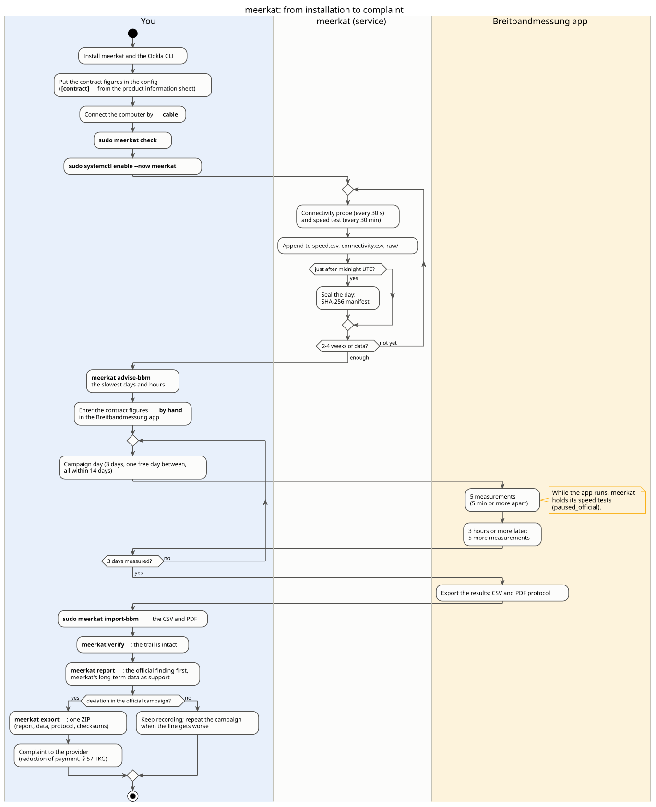
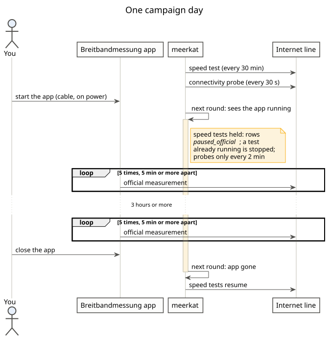

# User manual {#user_manual}

This manual takes you from a fresh install to a complaint your provider
can't brush aside. It is about *using* meerkat. The [README](../../README.md)
documents every command and setting in full.

[TOC]

## What meerkat does, and what counts in law {#um_overview}

meerkat runs on a Linux computer that is connected to the router by cable.
It records your line around the clock:
- a speed test every 30 minutes (Ookla Speedtest CLI);
- a connectivity probe every 30 seconds (ping and DNS), which catches
  outages.

Each day is sealed with a SHA-256 manifest, so later changes to the data
show.

In Germany, only the **Bundesnetzagentur's Breitbandmessung app** gives a
result that counts in law for a reduction of payment (§ 57 TKG). Its
*measurement campaign* is 30 measurements on three days. meerkat doesn't
replace the campaign. It does three things around it:
1. **Before:** it shows when your line is slowest, so you measure then.
2. **During:** it holds its own speed tests while the app runs, so it
   doesn't lower the official result.
3. **After:** it imports the official results and puts them at the top of
   one report. Weeks of its own data sit underneath as supporting evidence.

The whole process at a glance:



## 1. Install {#um_install}

On Debian 13 or Ubuntu 24.04:

```sh
sudo apt install ./meerkat_X.Y.Z_amd64.deb
```

The `.deb` comes from the
[latest release](https://github.com/carloslinares-eu/meerkat/releases).
On another distribution, or from a build, use `sudo packaging/install.sh`
instead. Either way you get the binary, the systemd service `meerkat`, the
user `meerkat` and the data directory `/var/lib/meerkat`.

meerkat also needs the **Ookla Speedtest CLI**. Install it as the README's
section *Install the Ookla CLI* describes.

To update later, install the new `.deb` or run `install.sh` again. The
service restarts with the new binary, and your config and data stay.

## 2. Configure {#um_configure}

The service reads `/etc/meerkat/config.toml`. Open it with:

```sh
sudoedit /etc/meerkat/config.toml
```

Two settings matter.

**Your contract.** The figures are in your provider's
*Produktinformationsblatt*: maximum, normally available and minimum speed,
in Mbit/s, for download and upload. For a made-up 250 Mbit/s tariff:

```toml
[contract]
download = { maximum = 250, normal = 200, minimum = 150 }
upload   = { maximum = 50,  normal = 40,  minimum = 30 }
```

**One test server.** Results from different servers aren't comparable.
`speedtest -L` lists servers near you; pick one and pin it:

```toml
[speed]
server_id = 12345
```

@warning A setting belongs under its own section. TOML puts every line into
the section above it, so `interval = "30m"` written below `[contract]`
becomes `contract.interval`. meerkat refuses a setting it doesn't know, and
the service won't start (see @ref um_trouble).

Leave the intervals alone unless you have a reason. A speed test every
30 minutes is what Ookla tolerates for weeks. At one every 5 minutes, Ookla
blocked the CLI after about 3 hours.

## 3. Check and start {#um_start}

```sh
sudo meerkat check --config /etc/meerkat/config.toml
```

Every line should say `[ ok ]`. Read any `[warn]`: the usual one is Wi-Fi,
and the cure is a cable. When you run `check` with sudo, the `data` line
shows root's own folder. That doesn't matter: the service writes to
`/var/lib/meerkat`.

Then start the service, and have it start at every boot:

```sh
sudo systemctl enable --now meerkat
journalctl -u meerkat -f     # watch it; Ctrl+C to stop watching
```

The first line should read
`recording to /var/lib/meerkat: speed test every 30m, connectivity every 30s`.
After that the log stays quiet. meerkat only logs when something changes:
an outage, a pause, a problem.

To read the data without sudo, add yourself to the `meerkat` group, then
log out and in again:

```sh
sudo usermod -aG meerkat "$USER"
```

## 4. Record {#um_record}

Let meerkat run for **two to four weeks**. That is long enough to show
whether the slow hours come back every day. During that time:
- **Keep the computer on and on the cable.** meerkat keeps it from going
  to sleep while it records. Wi-Fi tests are recorded, but never compared
  with the contract.
- **Avoid big transfers** on other devices (downloads, backups, 4K
  streaming). You can't stop everything for weeks; note what you can't
  avoid.
- **Look in now and then:** `meerkat report` (see @ref um_evidence) works
  at any time, also while the service records.

If Ookla blocks the CLI anyway ("Limit reached"), meerkat backs off by
itself. It waits 1 hour, then 2, 4, up to 8 hours. Those rows never count
against the line.

## 5. Plan the official campaign {#um_plan}

```sh
meerkat advise-bbm --config /etc/meerkat/config.toml --data-dir /var/lib/meerkat
```

It ranks the hours and weekdays of the last four weeks by how often the line
fell short of the contract. From that it suggests:
- three campaign days;
- two hours on each of those days, one for each block of five
  measurements.

A few days of data are enough for a first plan; more data makes it better.
The plan is only for you: `meerkat export` never includes it.

## 6. Run the campaign {#um_campaign}

Install the **Breitbandmessung desktop app** from
[breitbandmessung.de](https://breitbandmessung.de). Its *Festnetz-Check*
is the campaign.

**Before the first measurement**, enter your contract figures in the app
**by hand**, exactly as in your *Produktinformationsblatt*. Don't take them
from the app's list of tariffs, which can differ from your contract. The app
judges the campaign against whatever figures you enter.

**The rules** (the app enforces them):

| Rule | |
|---|---|
| Measurements | 30: 10 on each of 3 calendar days |
| Free day | at least one day without measurement between two measurement days |
| Span | all 3 days within 14 days |
| Within a day | at least 5 minutes between measurements; at least 3 hours between the 5th and the 6th |

**For every measurement:**
- use the cable, with the computer on power and Wi-Fi off;
- keep other devices quiet (no downloads, no streaming);
- close the app when a block of five is done.

You don't need to stop meerkat. It notices the app within about 30 seconds,
holds its speed tests while the app runs, and resumes when you close it:



@note meerkat can only see the app when both run on the same computer and
the app runs as a normal user. If it can't (for example, the app runs on
another computer on the same line), pause meerkat by hand:
`sudo meerkat pause --for 2h --data-dir /var/lib/meerkat`, and
`sudo meerkat resume --data-dir /var/lib/meerkat` to end the pause early.

## 7. Import the official results {#um_import}

After the third day, export from the app:
- the **CSV** of the measurements;
- the **PDF protocol** of the campaign.

Then import both into the service's data:

```sh
sudo meerkat import-bbm --data-dir /var/lib/meerkat Festnetz-Check_*.csv protocol.pdf
```

Both files are kept unchanged under `official/`, and the measurements go
into `official.csv`. Importing the same file twice adds nothing. The next
daily seal (just after midnight UTC) includes them.

`import-bbm` reads your files as root. It then gives up root before it
touches the data directory, so the new files belong to the service.

## 8. Build the evidence {#um_evidence}

The commands below are written for a member of the `meerkat` group;
otherwise put `sudo` in front.

```sh
# 1. Is the trail intact? (exit code 0 = yes)
meerkat verify --data-dir /var/lib/meerkat

# 2. The report: one self-contained HTML file; print it to PDF from the browser.
meerkat report --config /etc/meerkat/config.toml --data-dir /var/lib/meerkat

# 3. Everything for the provider in one ZIP.
meerkat export --config /etc/meerkat/config.toml --data-dir /var/lib/meerkat
```

**The report** starts with the official campaign, judged by the three
BNetzA rules, as *the legal finding*. A deviation exists, separately for
download and upload, if any one of these holds:
1. 90 % of the maximum speed isn't reached on two of the three days;
2. the normally available speed isn't reached in 90 % of the measurements;
3. the speed falls below the minimum on two of the three days.

Below that comes meerkat's own data, as *supporting evidence*:
- the same rules over every three-day window of the recording;
- the slow hours of the day;
- the outages;
- each official measurement next to meerkat's tests from the same half
  hour.

**The export** holds the report, the complete data with its manifests, the
`verify` result and a `SHA256SUMS` file. Anyone can check it with
`sha256sum -c`.

## 9. The complaint {#um_complaint}

If the official campaign shows a deviation, you may reduce your payment
(§ 57 TKG) or terminate the contract early. Write to your provider:
- **Attach:** the PDF protocol and the export ZIP.
- **Point to:** the report's official finding.
- **Set:** a deadline.

If the campaign shows no deviation but meerkat's long-term data does, keep
recording. Run a new campaign in the hours `advise-bbm` names.

## Troubleshooting {#um_trouble}

**The service doesn't start: `unknown setting 'contract.interval'`** (or
any other `unknown setting`). Exit status 2 means a config problem. Find it
with:

```sh
sudo journalctl -u meerkat -n 20 --no-pager
sudo meerkat check --config /etc/meerkat/config.toml
```

Usually a line sits under the wrong `[section]`. Move it, or delete it to
keep the default.

**`systemctl restart` does nothing: "Start request repeated too quickly".**
After a few failed starts in a row, systemd stops trying. Once the cause is
fixed:

```sh
sudo systemctl reset-failed meerkat
sudo systemctl restart meerkat
systemctl status meerkat     # should say: active (running)
```

**`check` warns that the Breitbandmessung app is running.** That is not an
error: speed tests wait until you close the app. If you aren't measuring,
close it.

**Rows with `rate_limited`.** Ookla blocked its CLI for a while; meerkat
waits and retries by itself. If it keeps happening, set a longer interval
under `[speed]`.

**A warning about Wi-Fi.** Connect the cable and switch Wi-Fi off. To skip
tests over Wi-Fi entirely, set `require_wired = true` under `[speed]`.

## Commands at a glance {#um_commands}

| When | Command |
|---|---|
| After install or a config change | `sudo meerkat check --config /etc/meerkat/config.toml` |
| Start recording | `sudo systemctl enable --now meerkat` |
| Watch it | `journalctl -u meerkat -f` |
| Plan the campaign | `meerkat advise-bbm --config /etc/meerkat/config.toml --data-dir /var/lib/meerkat` |
| Pause by hand | `sudo meerkat pause --for 2h --data-dir /var/lib/meerkat` |
| Import the official results | `sudo meerkat import-bbm --data-dir /var/lib/meerkat FILE.csv FILE.pdf` |
| Check the trail | `meerkat verify --data-dir /var/lib/meerkat` |
| The report | `meerkat report --config /etc/meerkat/config.toml --data-dir /var/lib/meerkat` |
| The bundle for the provider | `meerkat export --config /etc/meerkat/config.toml --data-dir /var/lib/meerkat` |

The diagrams are drawn with PlantUML from `workflow.puml` and
`campaign-day.puml` in this folder. After changing one, run `./render.sh`
and commit the SVGs too.
